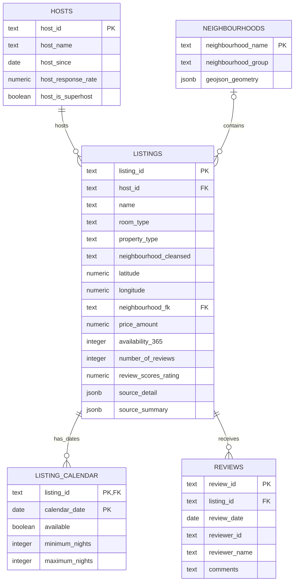

# Athens Airbnb Data — Proposed PostgreSQL ERD

This design is for the single download in this directory. It stores one row per listing and host, one row per listing/date in the calendar, one row per review, and one row per neighbourhood. There are no batch or snapshot tables.

## Entity relationship diagram



The neighbourhood relationship is optional: a listing may have no matched neighbourhood name. `neighbourhood_cleansed` is the likely join field; retain the original neighbourhood text as well. The CSV and GeoJSON neighbourhood names match in this download.

## Table responsibilities

| Table | One row per | Key and relationship |
|---|---|---|
| `hosts` | Airbnb host | `host_id` primary key. One host can have many listings. |
| `listings` | Airbnb listing | `listing_id` primary key; `host_id` references `hosts`. Stores the detailed listing values and summary fields. |
| `listing_calendar` | Listing and calendar date | Composite primary key `(listing_id, calendar_date)`; `listing_id` references `listings`. |
| `reviews` | Individual review | `review_id` primary key; `listing_id` references `listings`. |
| `neighbourhoods` | Neighbourhood boundary | `neighbourhood_name` primary key; listings can be mapped to it by the cleansed name. |

## Suggested PostgreSQL DDL

IDs are stored as `text` because Airbnb IDs are identifiers rather than quantities. `source_detail` and `source_summary` retain the original listing rows as JSONB, including source fields not promoted to typed columns below.

```sql
CREATE TABLE neighbourhoods (
    neighbourhood_name  text PRIMARY KEY,
    neighbourhood_group text,
    geojson_geometry    jsonb NOT NULL
);

CREATE TABLE hosts (
    host_id                     text PRIMARY KEY,
    host_profile_id             text,
    host_name                   text,
    host_url                    text,
    host_profile_url            text,
    host_since                  date,
    hosts_time_as_user_years    numeric(5,2),
    hosts_time_as_user_months   numeric(6,2),
    hosts_time_as_host_years    numeric(5,2),
    hosts_time_as_host_months   numeric(6,2),
    host_location               text,
    host_about                  text,
    host_response_time          text,
    host_response_rate          numeric(5,2),
    host_acceptance_rate        numeric(5,2),
    host_is_superhost            boolean,
    host_thumbnail_url          text,
    host_picture_url            text,
    host_neighbourhood          text,
    host_listings_count         integer,
    host_total_listings_count   integer,
    host_verifications          jsonb,
    host_has_profile_pic        boolean,
    host_identity_verified      boolean
);

CREATE TABLE listings (
    listing_id                   text PRIMARY KEY,
    host_id                      text REFERENCES hosts(host_id),
    listing_url                  text,
    scrape_id                    text,
    last_scraped                 date,
    source                       text,
    name                         text,
    description                  text,
    neighborhood_overview        text,
    picture_url                  text,

    -- Keep each source neighbourhood field distinct. Populate the FK only
    -- when the cleansed source name matches the neighbourhood lookup.
    neighbourhood                text,
    neighbourhood_cleansed       text,
    neighbourhood_group          text,
    neighbourhood_group_cleansed text,
    neighbourhood_fk             text REFERENCES neighbourhoods(neighbourhood_name),
    latitude                     numeric(9,6),
    longitude                    numeric(9,6),

    property_type                text,
    room_type                    text,
    accommodates                 smallint,
    bathrooms                    numeric(4,1),
    bathrooms_text               text,
    bedrooms                     smallint,
    beds                         numeric(5,1),
    amenities                    jsonb,

    -- Preserve raw price text; only fill numeric/currency fields after parsing.
    price_raw                    text,
    price_amount                 numeric(12,2),
    price_currency               text,
    price_quote_checkin_date     date,
    price_quote_checkout_date    date,
    price_quote_total_price      numeric(12,2),
    price_quote_price_per_night  numeric(12,2),
    price_quote_raw              text,

    minimum_nights               integer,
    maximum_nights               integer,
    minimum_minimum_nights       integer,
    maximum_minimum_nights       integer,
    minimum_maximum_nights       integer,
    maximum_maximum_nights       integer,
    minimum_nights_avg_ntm       numeric(6,2),
    maximum_nights_avg_ntm       numeric(6,2),
    calendar_updated             text,
    has_availability             boolean,
    availability_30              smallint,
    availability_60              smallint,
    availability_90              smallint,
    availability_365             smallint,
    calendar_last_scraped        date,
    availability_eoy             smallint,

    number_of_reviews            integer,
    number_of_reviews_ltm        integer,
    number_of_reviews_l30d       integer,
    number_of_reviews_ly         integer,
    estimated_occupancy_l365d    numeric(7,2),
    estimated_revenue_l365d      numeric(12,2),
    first_review                 date,
    last_review                  date,
    review_scores_rating         numeric(3,2),
    review_scores_accuracy       numeric(3,2),
    review_scores_cleanliness    numeric(3,2),
    review_scores_checkin        numeric(3,2),
    review_scores_communication  numeric(3,2),
    review_scores_location       numeric(3,2),
    review_scores_value          numeric(3,2),

    license                      text,
    instant_bookable             boolean,
    calculated_host_listings_count integer,
    calculated_host_listings_count_entire_homes integer,
    calculated_host_listings_count_private_rooms integer,
    calculated_host_listings_count_shared_rooms integer,
    reviews_per_month            numeric(7,2),

    source_detail                jsonb NOT NULL DEFAULT '{}'::jsonb,
    source_summary               jsonb
);

CREATE TABLE listing_calendar (
    listing_id      text NOT NULL REFERENCES listings(listing_id),
    calendar_date   date NOT NULL,
    available       boolean,
    minimum_nights  integer,
    maximum_nights  integer,
    PRIMARY KEY (listing_id, calendar_date)
);

CREATE TABLE reviews (
    review_id       text PRIMARY KEY,
    listing_id      text NOT NULL REFERENCES listings(listing_id),
    review_date     date,
    reviewer_id     text,
    reviewer_name   text,
    comments        text
);
```

The GeoJSON geometry is stored as JSONB, so the DDL works with standard PostgreSQL. For spatial queries, install PostGIS and use `geometry(MultiPolygon, 4326)` with a GiST index instead.

## Import and validation notes

- Load `listings.csv.gz` into `listings` and `hosts`. Use `listings.csv` to validate or populate `source_summary`; don’t create a second listing for the same ID.
- Load `calendar.csv.gz` into `listing_calendar`. Its natural key is `(listing_id, calendar_date)`.
- Load `reviews.csv.gz` into `reviews`. `reviews.csv` only has `listing_id` and `date`, so it is a reduced projection of the detailed reviews and should not be loaded as duplicate reviews.
- Load each GeoJSON feature’s `properties.neighbourhood` as `neighbourhood_name` and its `geometry` as `geojson_geometry`. Convert blank group values to `NULL`.
- Populate `listings.neighbourhood_fk` when a listing’s cleansed neighbourhood exactly matches the lookup; leave it `NULL` if it does not match, while retaining the original source names.
- Convert CSV `t`/`f` values to booleans and blank cells to `NULL`. Amenities and host verifications can be parsed into JSONB. Preserve the original rows in JSONB so the source values remain available.
- `price` is text in the source and may be blank or formatted. Keep it in `price_raw`; populate `price_amount` and `price_currency` only after confirming the parsing and currency.

## Useful indexes

```sql
CREATE INDEX listings_neighbourhood_idx
    ON listings (neighbourhood_cleansed);

CREATE INDEX listing_calendar_date_availability_idx
    ON listing_calendar (calendar_date, available);

CREATE INDEX reviews_listing_date_idx
    ON reviews (listing_id, review_date);
```
